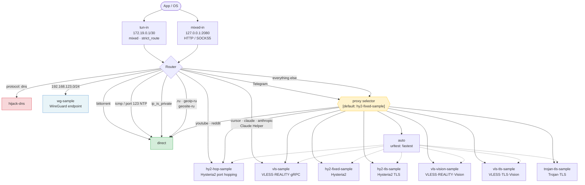
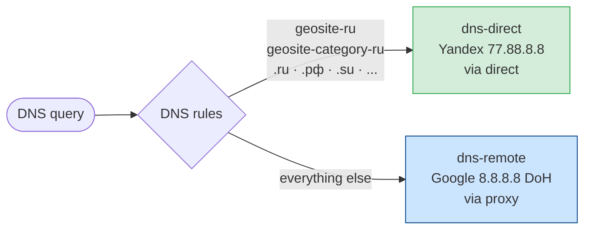
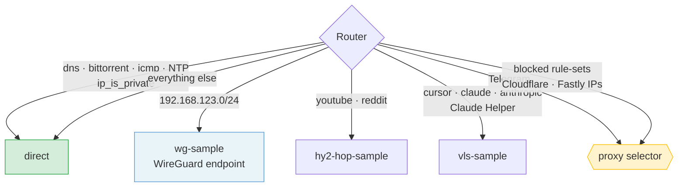

# Config architecture

**English** | [Русский](ARCHITECTURE.ru.md)

Most of this document describes `desktop.example.json` (proxy by default, Russian resources direct). How the `desktop-direct.example.json` template (direct by default, blocked resources through the proxy) differs is covered in [Direct-by-default scheme](#direct-by-default-scheme).

## Traffic flow

> WireGuard tunnels (`wg-*`) are **not part of the selector**: they are only used to reach corporate networks by specific IP subnets and always work, regardless of the selected proxy.

---

## DNS

---

## Config sections

### Inbounds

| Tag | Type | Address | Purpose |
|-----|------|---------|---------|
| `tun-in` | TUN | 172.19.0.1/30 | Captures all OS traffic through a virtual network interface |
| `mixed-in` | Mixed | 127.0.0.1:2080 | HTTP/SOCKS5 for apps with a manually configured proxy |

### Outbounds

| Tag | Protocol | Notes |
|-----|----------|-------|
| `proxy` | Selector | Manual proxy selection through the Clash API |
| `auto` | URLTest | Picks the fastest proxy automatically (checked once a minute) |
| `hy2-fixed-sample` | Hysteria2 | salamander obfs, fixed port, self-signed certificate |
| `hy2-hop-sample` | Hysteria2 | salamander obfs, port hopping (20000–50000) |
| `hy2-tls-sample` | Hysteria2 | salamander obfs, fixed port, valid TLS certificate (verification on) |
| `vls-sample` | VLESS | REALITY + gRPC + uTLS chrome |
| `vls-vision-sample` | VLESS | REALITY + Vision over TCP + uTLS chrome |
| `vls-tls-sample` | VLESS | plain TLS (certificate for the server's domain) + Vision + uTLS chrome |
| `trojan-tls-sample` | Trojan | plain TLS + uTLS chrome |
| `wg-sample` | WireGuard | Corporate network (endpoint, not part of the selector) |
| `direct` | Direct | Direct connection |

### Routing rules (in priority order)

| # | Condition | Outbound |
|---|-----------|----------|
| 1 | `inbound: tun-in / mixed-in` | action: sniff |
| 2 | `protocol: dns` | action: hijack-dns |
| 3 | `protocol: bittorrent` | `direct` |
| 4 | `port: 123` (NTP) | `direct` |
| 5 | IP in a WireGuard subnet | `wg-sample` |
| 6 | `network: icmp` (ping outside WireGuard subnets) | `direct` |
| 7 | All other private IPs | `direct` |
| 8 | Domain contains `youtube.com`, `reddit` | `hy2-hop-sample` |
| 9 | Domain contains `cursor`, `claude`, `anthropic` | `vls-sample` |
| 10 | Process `Claude Helper` (macOS) | `vls-sample` |
| 11 | Process `Telegram` (macOS) | `proxy` (selector) |
| 12 | Domain `.ru`/`.su`/`.xn--p1ai` OR `geoip-ru` / `geosite-category-ru` | `direct` |
| — | Everything else | `proxy` (selector) |

> **Important:** WireGuard subnets (`allowed_ips`) must come **before** `ip_is_private` and the `icmp` rule in the rules. Otherwise private addresses (10.x, 192.168.x, etc.) are matched first and go `direct`, bypassing the tunnel. The same goes for ping: with `icmp` above them, a ping to a work network would go to the internet instead of the tunnel.

> **Cross-platform:** `process_name` rules depend on the platform. On macOS, names have no extension (`Telegram`, `Claude Helper`). On **Windows**, use the executable name with `.exe` (`Telegram.exe`, `claude.exe`). On **Linux**, the name depends on the distribution (`telegram-desktop`, `telegram`, etc.). If the process name doesn't match, the rule is simply skipped and traffic falls through to the next conditions.

### Endpoints

WireGuard tunnels live in the `endpoints` section (not `outbounds`), as required since sing-box 1.11. Route rules still refer to them by tag like regular outbounds. Each tunnel has an `allowed_ips` field: only traffic to these subnets goes through the tunnel.

If the WireGuard server has a `PreSharedKey`, it must be set in the peer's `pre_shared_key` field; without it the handshake fails with `received invalid response message`.

### Rule sets

GeoIP and GeoSite rules are downloaded automatically on first start from [runetfreedom/russia-v2ray-rules-dat](https://github.com/runetfreedom/russia-v2ray-rules-dat):

| Tag | File |
|-----|------|
| `geoip-ru` | `rule-set-geoip/geoip-ru.srs` |
| `geosite-category-ru` | `rule-set-geosite/geosite-category-ru.srs` |
| `geosite-ru-available-only-inside` | `rule-set-geosite/geosite-ru-available-only-inside.srs` |

They are downloaded directly, bypassing the proxy, through the shared HTTP client `http-direct` from the `http_clients` section, which `route.default_http_client` makes the default. This replaces the `download_detour` field, deprecated since sing-box 1.14.

---

## Direct-by-default scheme

The `desktop-direct.example.json` template. Inbounds, outbounds, endpoints, the HTTP client and the Clash API are the same as in the main template. Routing and DNS differ.

| | `desktop.example.json` | `desktop-direct.example.json` |
|---|---|---|
| `route.final` | `proxy` | `direct` |
| Explicit `direct` rules | `.ru`/`.su`/`.xn--p1ai`, `geoip-ru`, `geosite-category-ru`, `geosite-ru-available-only-inside`, a single IP | none: direct is the default anyway |
| Explicit `proxy` rules | Telegram | Telegram + all rule-sets listed below |
| `dns.final` | `dns-remote` (via the proxy) | `dns-direct` |
| DNS rules | Russian domains → `dns-direct` | blocked domains → `dns-remote` |

Blocked domains are resolved through `dns-remote` (Google DoH via the proxy), because a Russian DNS server may return a block-page address for them. DNS rules only use `geosite-*`: IP lists (`geoip-*`) in DNS rules without `match_response` are deprecated since sing-box 1.14.

### Rule sets

The set mirrors the `ru-blocked-dev` preset from [glinet-geo-lists](https://github.com/kolaqsq/glinet-geo-lists): popular services blocked or throttled in Russia, plus AI, developer services and other services that refuse to work with Russian users. The files come from the same [runetfreedom/russia-v2ray-rules-dat](https://github.com/runetfreedom/russia-v2ray-rules-dat).

| Group | Rule sets |
|-------|-----------|
| Roskomnadzor blocks (antifilter community list) | `geosite-antifilter-download-community`, `geoip-ru-blocked-community` |
| Messengers and video | `geosite-youtube`, `geosite-telegram`, `geoip-telegram`, `geosite-discord` |
| AI | `geosite-category-ai-!cn` |
| Development | `geosite-jetbrains`, `geosite-hashicorp`, `geosite-docker`, `geosite-gitlab`, `geosite-atlassian`, `geosite-oracle` |
| Design and work | `geosite-notion`, `geosite-figma`, `geosite-canva`, `geosite-autodesk`, `geosite-adobe`, `geosite-unity` |
| Hardware and drivers | `geosite-intel`, `geosite-nvidia`, `geosite-amd` |
| Streaming | `geosite-netflix`, `geosite-spotify`, `geosite-disney`, `geosite-hbo`, `geosite-primevideo` |
| Other | `geosite-ookla-speedtest` |
| CDN (by IP) | `geoip-cloudflare`, `geoip-fastly` |

The rule-sets are declared as two entries with multiple tags (`"tag": [...]`, `{tag}` in `url`), a sing-box 1.14 feature. To add a service, add its tag to `route.rule_set` and to the `proxy` rule in `route.rules`, and for `geosite-*` also to the DNS rule. Available files: the `release` branch, `sing-box/` folder of the runetfreedom repository.

### CDN: Cloudflare and Fastly

`geoip-cloudflare` and `geoip-fastly` are not lists of blocked sites: they are the IP ranges of these CDNs. From Russia, large downloads from Cloudflare and Fastly stall, so sites behind them partly break even though they are not blocked. Package registries are a typical case: Maven Central, `repo.reactnative.dev`, Gradle, JitPack, npm, yarn and CocoaPods are behind Cloudflare, RubyGems and `githubusercontent.com` are behind Fastly (Gradle fails with `Read timed out` on React Native `.aar` files).

The trade-off:
- A noticeable part of the web goes through the proxy, including some Russian sites behind Cloudflare.
- These are IP rules, so they only work through TUN, where the destination IP is known. An app configured to use the mixed proxy (`127.0.0.1:2080`) sends a domain, and the rule does not match. If you build through the mixed proxy, add the registries as a `domain_suffix` rule.
- IP rule-sets are not used in DNS rules (deprecated since sing-box 1.14 without `match_response`), so these sites are resolved through `dns-direct`.
