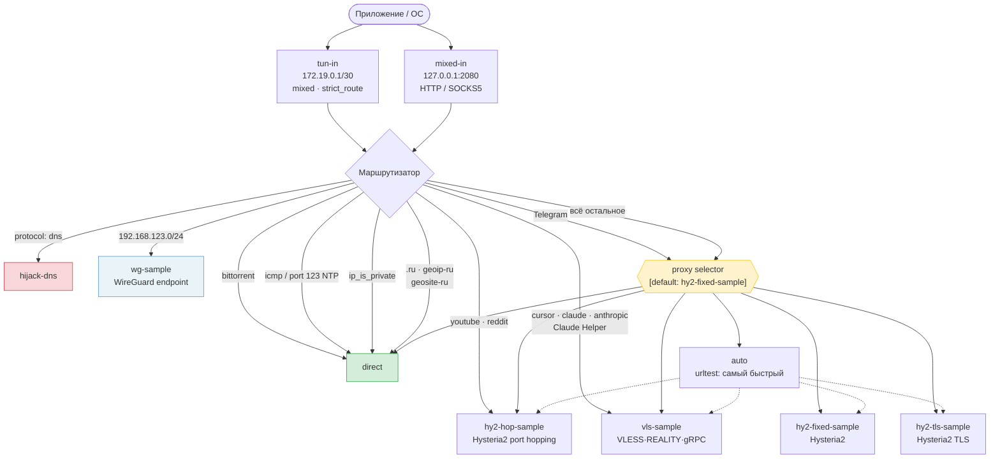
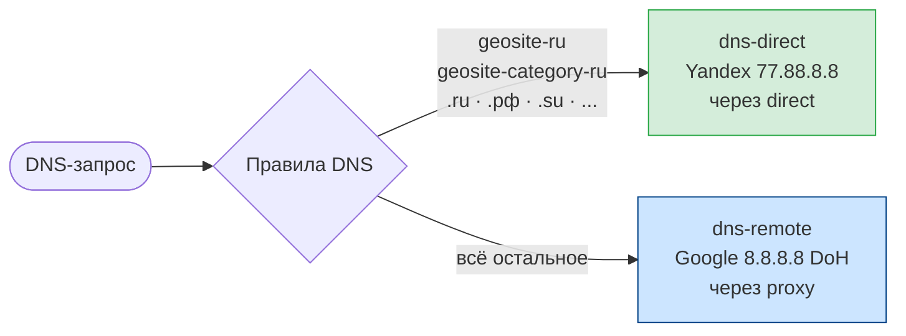
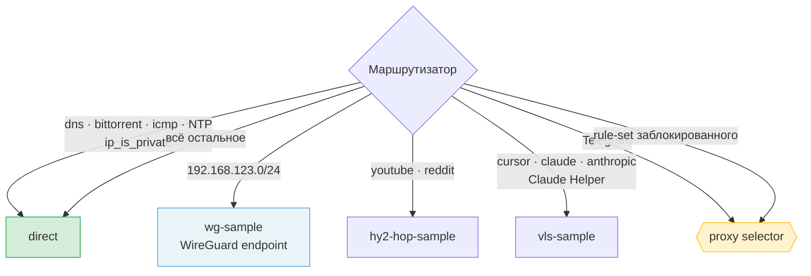

# Архитектура конфига

Основная часть описывает `desktop.example.json` (по умолчанию прокси, РФ напрямую). Отличия шаблона `desktop-direct.example.json` (по умолчанию напрямую, заблокированное через прокси) — в разделе [Схема «по умолчанию напрямую»](#схема-по-умолчанию-напрямую).

## Общая схема прохождения трафика

> WireGuard-туннели (`wg-*`) **не входят в selector** — они используются только для доступа к корпоративным сетям по конкретным IP-подсетям и работают всегда, независимо от выбранного прокси.

---

## DNS

---

## Секции конфига

### Inbounds

| Тег | Тип | Адрес | Назначение |
|-----|-----|-------|-----------|
| `tun-in` | TUN | 172.19.0.1/30 | Перехват всего трафика ОС через виртуальный сетевой интерфейс |
| `mixed-in` | Mixed | 127.0.0.1:2080 | HTTP/SOCKS5 для приложений с ручной настройкой прокси |

### Outbounds

| Тег | Протокол | Особенности |
|-----|----------|------------|
| `proxy` | Selector | Ручной выбор прокси через Clash API |
| `auto` | URLTest | Автовыбор самого быстрого прокси (проверка раз в минуту) |
| `hy2-fixed-sample` | Hysteria2 | obfs salamander, фиксированный порт, самоподписанный сертификат |
| `hy2-hop-sample` | Hysteria2 | obfs salamander, port hopping (20000–50000) |
| `hy2-tls-sample` | Hysteria2 | obfs salamander, фиксированный порт, валидный TLS-сертификат (проверка включена) |
| `vls-sample` | VLESS | REALITY + gRPC + uTLS chrome |
| `wg-sample` | WireGuard | Корпоративная сеть (endpoint, не входит в selector) |
| `direct` | Direct | Прямое подключение |

### Правила маршрутизации (в порядке приоритета)

| # | Условие | Аутбаунд |
|---|---------|---------|
| 1 | `inbound: tun-in / mixed-in` | action: sniff |
| 2 | `protocol: dns` | action: hijack-dns |
| 3 | `protocol: bittorrent` | `direct` |
| 4 | `network: icmp` | `direct` |
| 5 | `port: 123` (NTP) | `direct` |
| 6 | IP в подсети WireGuard | `wg-sample` |
| 7 | Все остальные приватные IP | `direct` |
| 8 | Домен содержит `youtube.com`, `reddit` | `hy2-hop-sample` |
| 9 | Домен содержит `cursor`, `claude`, `anthropic` | `vls-sample` |
| 10 | Процесс `Claude Helper` (macOS) | `vls-sample` |
| 11 | Процесс `Telegram` (macOS) | `proxy` (selector) |
| 12 | Домен `.ru`/`.su`/`.xn--p1ai` ИЛИ `geoip-ru` / `geosite-category-ru` | `direct` |
| — | Всё остальное | `proxy` (selector) |

> **Важно:** WireGuard-подсети (`allowed_ips`) обязательно должны стоять в правилах **до** `ip_is_private`, иначе приватные адреса (10.x, 192.168.x и т.д.) перехватятся раньше и пойдут в `direct`, минуя туннель.

> **Кросс-платформенность:** правила `process_name` зависят от платформы. На macOS используются имена без расширения (`Telegram`, `Claude Helper`). На **Windows** нужно указывать имя исполняемого файла с `.exe` (`Telegram.exe`, `claude.exe`). На **Linux** имя зависит от дистрибутива (`telegram-desktop`, `telegram` и т.д.). Если имя процесса не совпадает — правило просто пропускается, трафик уходит по следующим условиям.

### Endpoints

WireGuard-туннели вынесены в секцию `endpoints` (не `outbounds`) — это требование sing-box 1.11+. В route rules они по-прежнему доступны по тегу как обычные аутбаунды. Для каждого туннеля указывается поле `allowed_ips` — только трафик к этим подсетям пойдёт через туннель.

Если на сервере WireGuard настроен `PreSharedKey`, его необходимо указать в поле `pre_shared_key` у peer — без него handshake завершится с ошибкой `received invalid response message`.

### Rule sets

Правила GeoIP и GeoSite скачиваются автоматически при первом запуске из репозитория [runetfreedom/russia-v2ray-rules-dat](https://github.com/runetfreedom/russia-v2ray-rules-dat):

| Тег | Файл |
|-----|------|
| `geoip-ru` | `rule-set-geoip/geoip-ru.srs` |
| `geosite-category-ru` | `rule-set-geosite/geosite-category-ru.srs` |
| `geosite-ru-available-only-inside` | `rule-set-geosite/geosite-ru-available-only-inside.srs` |

Скачивание идёт напрямую, мимо прокси, через общий HTTP-клиент `http-direct` из секции `http_clients`: он назначен клиентом по умолчанию в `route.default_http_client`. Это замена устаревшего с sing-box 1.14 поля `download_detour`.

---

## Схема «по умолчанию напрямую»

Шаблон `desktop-direct.example.json`. Inbounds, outbounds, endpoints, HTTP-клиент и Clash API те же, что в основном шаблоне. Отличаются маршрутизация и DNS.

| | `desktop.example.json` | `desktop-direct.example.json` |
|---|---|---|
| `route.final` | `proxy` | `direct` |
| Явные правила в `direct` | `.ru`/`.su`/`.xn--p1ai`, `geoip-ru`, `geosite-category-ru`, `geosite-ru-available-only-inside`, отдельный IP | нет: direct и так по умолчанию |
| Явные правила в `proxy` | Telegram | Telegram + все rule-set из списка ниже |
| `dns.final` | `dns-remote` (через прокси) | `dns-direct` |
| DNS-правила | российские домены → `dns-direct` | заблокированные домены → `dns-remote` |

Заблокированные домены резолвятся через `dns-remote` (Google DoH через прокси): российский DNS может вернуть для них адрес заглушки. В DNS-правилах используются только `geosite-*`: IP-списки (`geoip-*`) в DNS-правилах без `match_response` устарели с sing-box 1.14.

### Rule sets

Набор повторяет пресет `ru-blocked-dev` из [glinet-geo-lists](https://github.com/kolaqsq/glinet-geo-lists): популярные заблокированные или замедленные в России сервисы плюс AI, сервисы для разработки и другие сервисы, которые сами не работают с российскими пользователями. Файлы берутся из того же [runetfreedom/russia-v2ray-rules-dat](https://github.com/runetfreedom/russia-v2ray-rules-dat).

| Группа | Rule sets |
|--------|-----------|
| Блокировки РКН (community-список antifilter) | `geosite-antifilter-download-community`, `geoip-ru-blocked-community` |
| Мессенджеры и видео | `geosite-youtube`, `geosite-telegram`, `geoip-telegram`, `geosite-discord` |
| AI | `geosite-category-ai-!cn` |
| Разработка | `geosite-jetbrains`, `geosite-hashicorp`, `geosite-docker`, `geosite-gitlab`, `geosite-atlassian`, `geosite-oracle` |
| Дизайн и работа | `geosite-notion`, `geosite-figma`, `geosite-canva`, `geosite-autodesk`, `geosite-adobe`, `geosite-unity` |
| Железо и драйверы | `geosite-intel`, `geosite-nvidia`, `geosite-amd` |
| Стриминг | `geosite-netflix`, `geosite-spotify`, `geosite-disney`, `geosite-hbo`, `geosite-primevideo` |
| Прочее | `geosite-ookla-speedtest` |

Rule sets объявлены двумя записями с несколькими тегами (`"tag": [...]`, `{tag}` в `url`), это возможность sing-box 1.14. Чтобы добавить сервис, допиши его тег и в `route.rule_set`, и в правило `proxy` в `route.rules`, а для `geosite-*` ещё и в DNS-правило. Список доступных файлов: ветка `release`, папка `sing-box/` в репозитории runetfreedom.
